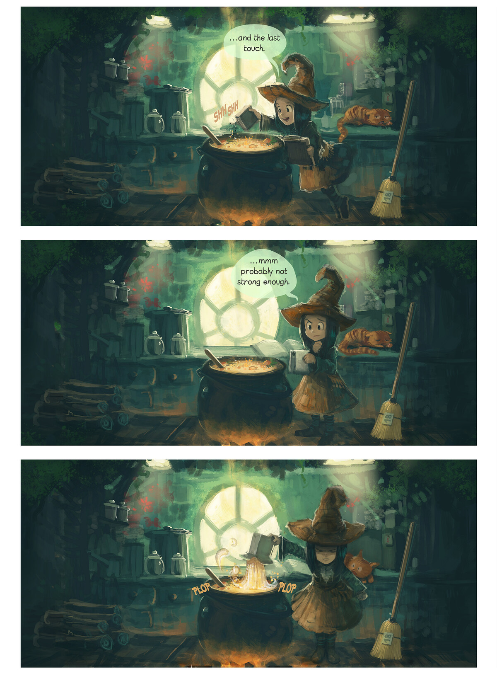
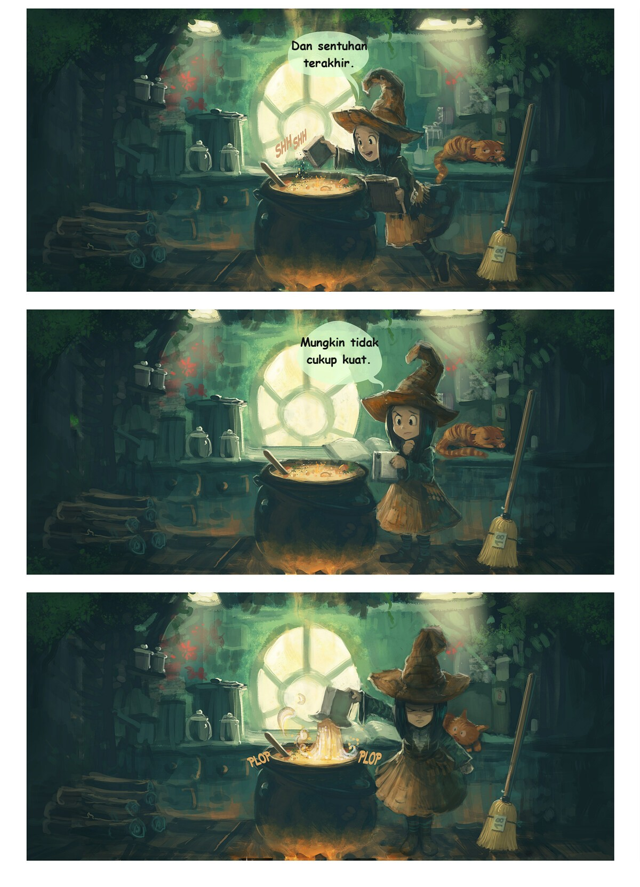

# MangaFlow

**Penerjemah manga, manhwa, dan webtoon yang berjalan di komputer sendiri.**
OCR, terjemahan, pembersihan balon, dan penataan huruf dikerjakan secara lokal — tanpa kredit, tanpa langganan, dan tanpa antrean.

| Sebelum | Sesudah |
| --- | --- |
|  |  |

> Contoh halaman: *Pepper & Carrot* oleh David Revoy, lisensi [CC BY 4.0](https://www.peppercarrot.com/).

## Daftar isi

- [Fitur](#fitur)
- [Persyaratan](#persyaratan)
- [Instalasi](#instalasi)
- [Cara pakai](#cara-pakai)
- [Ekstensi Chrome](#ekstensi-chrome)
- [Model](#model)
- [Mesin terjemahan](#mesin-terjemahan)
- [Gaya bahasa](#gaya-bahasa)
- [Melatih model NLLB](#melatih-model-nllb)
- [Konfigurasi](#konfigurasi)
- [Struktur proyek](#struktur-proyek)
- [API singkat](#api-singkat)
- [Tips kualitas](#tips-kualitas)
- [Troubleshooting](#troubleshooting)
- [Privasi & lisensi](#privasi--lisensi)

## Fitur

- **Batch upload** gambar (PNG, JPG, WEBP, BMP, TIFF, GIF) atau arsip **ZIP/CBZ**.
- **OCR lokal** dengan RapidOCR/ONNX, termasuk teks vertikal Jepang dan balon elips.
- **Penggabungan kolom**: potongan kolom vertikal yang masih berada dalam satu balon digabung lagi sebelum diterjemahkan, sehingga tidak muncul dua teks bertumpuk. Dua balon yang berdempetan tetap dipisah: penggabungan hanya dilakukan bila region balonnya hampir identik (selisih ≤8 px) atau tumpang tindih ≥90%. Untuk teks putih di panel gelap, kolom juga dipisah bila jaraknya lebih dari 24 px atau ada garis putih tipis di celahnya.
- **Terjemahan lokal** tanpa limit lewat Argos/OPUS (cepat) atau NLLB-200 (lebih baik untuk CJK). Jika sumber memakai **Deteksi otomatis** dan teksnya Jepang/Korea/Tionghoa, NLLB-200 dipakai otomatis ketika modelnya tersedia.
- **NLLB-200 manga (1.3B)**: model 1.3B lebih akurat untuk kalimat panjang. Jika model hasil fine-tune belum ada, mesin ini otomatis memakai NLLB-200 1.3B dasar dan menandainya “belum fine-tune”.
- **Mesin opsional**: DeepL, Gemini, Microsoft Translator, Google, MyMemory, LibreTranslate, Ollama, dan endpoint OpenAI-compatible.
- **Pengaturan mesin di UI**: tombol **Pengaturan mesin & kunci API** menyimpan kunci/URL ke `data/settings.json` dan langsung aktif tanpa restart. Mesin yang belum siap diberi label **butuh kunci**, **butuh URL**, atau **tidak aktif**, bukan “belum siap”.
- **Gaya bahasa Indonesia**: pilih **Santai** (default, bahasa sehari-hari), **Netral**, atau **Baku**.
- **Model NLLB hasil latihan**: alur distilasi DeepL + LoRA untuk gaya terjemahan yang lebih natural (lihat `training/`). Sampai model latihan tersedia, mesin **NLLB-200 manga** memakai model 1.3B dasar.
- **Redraw otomatis**: huruf lama dihapus dengan fill lokal untuk area teks dan inpainting untuk artwork. Balon padat boleh diratakan seluruh interiornya dengan kontur dikikis 2 px agar tidak ada tambalan persegi, sedangkan komponen yang menyatu dengan artwork tetap dibatasi ke kotak teks. Border caption/panel dan garis pemisah caption yang berdempetan dilindungi, sehingga dua caption yang bersentuhan tetap terpisah. Teks putih di panel gelap dideteksi dengan white top-hat agar highlight artwork tidak ikut terhapus.
- **Tata huruf adaptif**: teks Latin/Indonesia selalu horizontal dan tidak pernah diputar. Jika ruang sempit, teks dibungkus menjadi beberapa baris dan ukuran huruf dikecilkan; kata tidak dipotong di tengah kecuali benar-benar tidak muat. Ukuran mengikuti tinggi huruf asli, warna dipilih dari latar bersih, dan latar campuran otomatis diberi garis tepi kontras.
- **Editor per halaman**: ubah terjemahan, lewati balon, atur jenis huruf, ukuran, warna, dan garis tepi; render ulang seketika.
- **Viewer** dengan slider sebelum/sesudah, pin balon, zoom, dan navigasi halaman.
- **Ekstensi Chrome** untuk menerjemahkan gambar manga langsung dari halaman web, termasuk mode auto translate dan screenshot dengan crop.
- **Unduhan** per halaman atau satu chapter dalam ZIP (termasuk `dialog.txt`).
- **Riwayat job** tersimpan di disk dan bisa dibuka kembali atau dihapus.
- Antarmuka bahasa Indonesia, tema manga gelap, responsif untuk layar kecil.

## Persyaratan

- **Python 3.11+** — diuji di Windows dengan Python 3.14.
- **RAM** minimal 2 GB; 4 GB atau lebih disarankan, dan 8 GB jika sering memakai NLLB-200 1.3B.
- **Ruang disk** sekitar 1 GB untuk model OCR + Argos, sekitar 2,2 GB dengan NLLB 600M + 1.3B, atau sekitar 2,5 GB jika model hasil latihan juga diekspor.
- **Internet sekali** saat model pertama kali diunduh. Setelah model tersimpan, proses bisa berjalan offline.
- Tidak membutuhkan GPU, Node.js, atau langkah build frontend.

## Instalasi

### Cara cepat (Windows)

```bat
run.bat
```

Skrip akan:

1. Membuat virtual environment `.venv` jika belum ada.
2. Memasang dependensi dari `requirements.txt`.
3. Menjalankan server di `http://127.0.0.1:8765`.
4. Membuka browser setelah server siap.

Jika server sudah berjalan, `run.bat` hanya membuka browser tanpa menjalankan server kedua.

### Manual

```bash
cd manga-translator
python -m venv .venv

# Windows
.venv\Scripts\activate

# Linux/macOS
source .venv/bin/activate

pip install -r requirements.txt
python app.py
```

Buka `http://127.0.0.1:8765`.

### Menjalankan dengan port lain

```powershell
# Windows PowerShell
$env:MANGA_PORT = "9000"
python app.py
```

```bash
# Linux/macOS
MANGA_PORT=9000 python app.py
```

## Cara pakai

1. Buka halaman utama, lalu klik **Mulai terjemahkan**.
2. Tarik gambar/ZIP/CBZ ke dropzone, atau klik **Lihat contoh** untuk mencoba halaman demo.
3. Pilih bahasa sumber (atau **Deteksi otomatis**), bahasa target, dan mesin terjemahan.
4. Klik **Terjemahkan sekarang** dan tunggu halaman selesai diproses.
5. Buka halaman untuk memeriksa hasil, mengedit dialog, melewati balon tertentu, atau mengatur gaya huruf.
6. Unduh halaman atau seluruh chapter dalam ZIP.

Semua job dan hasil tersimpan di `data/jobs/`. Riwayat bisa dibuka lewat tombol **Riwayat** di header.

## Ekstensi Chrome

Folder [`extension/`](extension/) berisi ekstensi Manifest V3 untuk menerjemahkan manga langsung dari halaman web. Ekstensi hanya menjadi antarmuka: OCR, terjemahan, redraw, dan typesetting tetap dikerjakan server MangaFlow lokal. Tidak ada akun, kredit, atau unggahan ke cloud.

### Instalasi

1. Jalankan server MangaFlow (`run.bat` atau `python app.py`).
2. Buka `chrome://extensions`, aktifkan **Developer mode**.
3. Klik **Load unpacked**, lalu pilih folder `manga-translator/extension`.
4. Sematkan ikon MangaFlow ke toolbar.

Ekstensi membutuhkan Chrome 105+; shortcut `Ctrl+Shift+S` paling andal di Chrome 127+.

### Cara pakai singkat

- **Terjemahkan halaman** — buka halaman manga, klik ikon MangaFlow, lalu klik **Terjemahkan halaman**. Gambar terbesar di halaman diganti dengan hasil terjemahan.
- **Auto translate page** — aktifkan toggle agar halaman manga diproses otomatis saat dibuka.
- **Screenshot** — klik kartu **Screenshot** atau tekan `Ctrl+Shift+S` / `Command+Shift+S`, pilih crop, lalu **Terjemahkan area**. Berguna untuk canvas, background-image, atau situs dengan CSP ketat.
- **Viewer** — hasil screenshot/halaman bisa dibandingkan sebelum-sesudah, diunduh, atau dibuka di editor MangaFlow.
- **Pengaturan** — ubah alamat server (misalnya port 9000), mesin, gaya bahasa, dan bahasa target. Kunci API tetap diatur di halaman MangaFlow, bukan di ekstensi.

Panduan lengkap, izin, batasan, dan troubleshooting ada di [`extension/README.md`](extension/README.md).

### Izin dan privasi ekstensi

Ekstensi meminta `tabs`, `activeTab`, `storage`, serta akses `http://*/*`, `https://*/*`, dan `<all_urls>`. Izin host luas diperlukan untuk mengambil gambar manga dari CDN mana pun, menangkap tab untuk fitur Screenshot, dan menghubungi server lokal; tanpa itu, gambar lintas-origin dan `captureVisibleTab` bisa gagal. Gambar hanya dikirim ke alamat server yang diisi di Pengaturan. Pengaturan disimpan di `chrome.storage.sync` (bisa ikut tersinkron ke akun Chrome jika sinkronisasi aktif), sedangkan job terakhir di `chrome.storage.local`. Tidak ada telemetri atau iklan.

## Model

Model disimpan di `data/models/` dan diunduh sekali. Setelah tersedia, pipeline bisa berjalan tanpa internet.

| Model | Ukuran | Kapan diunduh | Catatan |
| --- | --- | --- | --- |
| RapidOCR | ±30 MB | Saat OCR pertama | Otomatis oleh RapidOCR |
| Argos/OPUS | ±70–200 MB per pasangan | Saat bahasa target dipakai | Otomatis dari indeks Argos; memakai pivot Inggris |
| NLLB-200 distilled 600M int8 | ±600 MB | Manual, sekali | Cepat; dipakai mesin **NLLB-200 (lokal)** |
| NLLB-200 distilled 1.3B int8 | ±1,34 GB | Manual, sekali | Lebih akurat untuk kalimat panjang; dipakai mesin **NLLB-200 manga** bila model latihan belum ada |
| Ollama / OpenAI-compatible | Tergantung model | Di luar aplikasi | Opsional, butuh server/model sendiri |

### Menyiapkan NLLB-200

Model 600M untuk mesin **NLLB-200 (lokal)**:

```bash
python samples/download_nllb.py
```

Skrip mengunduh `model.bin`, `sentencepiece.bpe.model`, `shared_vocabulary.txt`, dan `config.json` ke `data/models/nllb-200-distilled-600M-ct2-int8`. Setelah selesai, muat ulang halaman; opsi **NLLB-200 (lokal)** akan aktif di menu mesin terjemahan.

Model 1.3B untuk mesin **NLLB-200 manga**:

```bash
python samples/download_nllb_large.py
```

Model disimpan di `data/models/nllb-200-distilled-1.3B-ct2-int8`. Unduhan memakai HTTP Range, jadi kalau koneksi putus, jalankan perintah yang sama lagi dan unduhan melanjutkan dari posisi terakhir. Ukuran `model.bin` diverifikasi tepat 1.377.755.738 byte. Tokenizer NLLB sama untuk semua ukuran; skrip menyalinnya dari model 600M jika sudah ada.

Urutan pemilihan model untuk mesin **NLLB-200 manga**: model hasil fine-tune (`data/models/nllb-200-manga-ct2-int8`) → NLLB 1.3B → tidak aktif. Jadi mesin ini tetap bisa dipakai sebelum fine-tune; label di UI dan hasil tes akan menyebut **“belum fine-tune”**.

Perkiraan performa CPU: 1–2 detik per baris untuk 600M, dan sekitar dua kali lebih lama untuk 1.3B setelah model dimuat. Muat pertama memakan beberapa detik dan RAM sekitar 1 GB (600M) atau 2 GB (1.3B). Untuk chapter panjang, Argos/OPUS lebih cepat; NLLB cocok untuk kualitas Jepang/Korea/Tionghoa yang lebih baik.

### Argos/OPUS

Model diunduh otomatis saat pertama kali dipakai. Jika komputer sedang offline, siapkan model dengan sekali menerjemahkan halaman ke bahasa target saat masih ada koneksi. Setelah itu model tersimpan dan tidak perlu internet lagi.

Katalog paket Argos ada di `server/argos_index.json`, jadi daftar bahasa tetap bisa dibuka tanpa internet.

## Mesin terjemahan

| ID | Nama | Lokal | Keterangan |
| --- | --- | --- | --- |
| `local` | Lokal (tanpa limit) | Ya | Argos/OPUS, cepat di CPU; CJK otomatis ke NLLB-200 saat sumber auto |
| `nllb` | NLLB-200 (lokal) | Ya | NLLB-200 600M, 200 bahasa, cepat; offline setelah model ada |
| `nllb-tuned` | NLLB-200 manga (1.3B) | Ya | NLLB 1.3B + kamus istilah manga; memakai model fine-tune jika sudah ada |
| `google` | Google Translate | Tidak | Online, bisa kena rate limit |
| `mymemory` | MyMemory | Tidak | Online, kuota harian |
| `deepl` | DeepL | Tidak | Online; isi kunci lewat **Pengaturan mesin** atau `DEEPL_API_KEY` |
| `gemini` | Gemini | Tidak | Online; isi kunci lewat **Pengaturan mesin** atau `GEMINI_API_KEY` |
| `microsoft` | Microsoft Translator | Tidak | Online; isi kunci Azure lewat **Pengaturan mesin** atau `AZURE_TRANSLATOR_KEY` |
| `libretranslate` | LibreTranslate | Tergantung server | Isi URL lewat **Pengaturan mesin** atau `LIBRETRANSLATE_URL` |
| `ollama` | Ollama (LLM lokal) | Ya | Butuh server Ollama yang berjalan; atur URL/model di **Pengaturan mesin** |
| `openai` | OpenAI-compatible | Tergantung endpoint | Atur base URL, kunci, dan model di **Pengaturan mesin** |

Mesin yang belum bisa dipakai tetap terlihat di daftar dengan label yang jelas: **butuh kunci** (DeepL, Gemini, Microsoft), **butuh kunci/endpoint** (OpenAI-compatible), **butuh URL** (LibreTranslate), atau **tidak aktif** (Ollama). Ini bukan kegagalan aplikasi; tinggal lengkapi kredensial di **Pengaturan mesin & kunci API**. Kunci disimpan di `data/settings.json` dan langsung dipakai. Environment variable tetap menang atas file, sehingga deployment bisa mengunci konfigurasi.

### Istilah manga

NLLB tidak mengenal nama dan istilah dari serial tertentu. MangaFlow memperbaiki beberapa istilah yang sering salah sebelum dan sesudah terjemahan:

| Sumber | Hasil yang sering muncul | Perbaikan |
| --- | --- | --- |
| `オフューカス` | “Offucus”, “O'Focus” | **Ophiuchus** |
| `蛇遣い` | “Serpent Retrieval”, “Snake Squad” | **Pemegang Ular** |
| `十三星` | “13 Stars”, “The Thirteenth Star” | **Tiga Belas Bintang** |
| `霸道` | “Tunnel”, “Terowongan” | **Jalan Agung** |
| `魔神族七曜` | “dewa setan minggu” | **Tujuh Dewa Iblis** |
| `魔神族` | “dewa-dewi”, “dewa sihir” | **klan iblis** |

Kamus ini konservatif: penggantian hanya dilakukan jika istilah sumbernya memang muncul. Untuk nama diri lain, edit manual di viewer.

### Fallback otomatis

Jika mesin online gagal dan **fallback** aktif, MangaFlow mencoba jalur berikut sebelum menyerah:

1. **Google Translate** gagal (misalnya rate limit 429) → coba **MyMemory**.
2. MyMemory gagal atau kuotanya habis → mesin lokal.
3. Fallback lokal memakai **NLLB-200** jika teks sumber terdeteksi Jepang, Korea, atau Tionghoa dan modelnya tersedia; jika tidak, dipakai **Argos/OPUS**.
4. Jika kamu memilih sumber **Deteksi otomatis** dan mesin `local`, NLLB-200 juga dipakai otomatis untuk teks CJK sejak awal. Ini menghindari pivot Jepang → Inggris → Indonesia milik Argos yang sering merusak kalimat.

Setiap perpindahan mesin dicatat sebagai **Catatan** di halaman job.

## Gaya bahasa

Pilihan **Pengaturan lanjutan → Gaya bahasa** hanya berlaku untuk target Indonesia:

| Gaya | Contoh |
| --- | --- |
| **Santai** (default) | “Aku nggak tahu apa yang lagi terjadi, tapi aku akan cari tahu.” |
| **Netral** | “Aku tidak tahu, tapi aku akan pergi.” |
| **Baku** | “Saya tidak tahu, tetapi saya akan pergi.” |

Gaya santai memakai aturan pengganti kata yang konservatif (kata utuh), misalnya `saya → aku`, `tidak → nggak`, `sudah → udah`, `sangat baik → baik banget`. Teks tetap bisa diedit manual di viewer. Untuk mesin LLM (Ollama, OpenAI-compatible, Gemini), gaya bahasa juga dimasukkan ke prompt agar hasilnya tidak perlu banyak diubah.

## Melatih model NLLB

NLLB-200 dasar bagus untuk makna, tetapi terdengar seperti bahasa buku. Folder `training/` berisi alur untuk membuat model yang lebih mirip hasil DeepL:

1. Kumpulkan dialog Jepang dari hasil OCR job.
2. Terjemahkan dengan DeepL sebagai guru.
3. Fine-tune NLLB-200 dengan LoRA.
4. Ekspor ke CTranslate2 int8 dan pakai lewat mesin **NLLB-200 manga (1.3B)**.

Panduan lengkap, termasuk kebutuhan GPU, format data, evaluasi, dan troubleshooting, ada di [`training/README.md`](training/README.md). Jika tidak punya GPU lokal, buka [`training/colab_finetune.ipynb`](training/colab_finetune.ipynb) di Google Colab: notebook itu menjalankan seluruh alur di GPU T4 gratis.

Tanpa kunci DeepL, pengumpulan data bisa memakai guru gratis:

```bash
python training/collect_deepl.py --teacher google --max-lines 1000 --delay 0.3
```

Kualitas guru gratis tidak sebaik DeepL, tetapi cukup untuk percobaan awal. Target data minimal 500 pasangan; 3.000+ lebih stabil.

> Toolkit sudah tersedia, tetapi model latihan belum dibuat karena lingkungan pengembangan belum memiliki GPU, dependensi latihan, dataset berpasangan, atau kunci DeepL. Tanpa itu, melatih model 600M/1.3B tidak realistis. Mesin **NLLB-200 manga (1.3B)** tetap bisa dipakai dengan model 1.3B dasar; UI akan menandainya “belum fine-tune”. Gunakan Colab atau mesin GPU lain untuk benar-benar melatihnya.

## Konfigurasi

Semua lewat environment variable (opsional). Kunci dan URL mesin juga bisa diisi lewat **Pengaturan mesin** di UI; nilainya disimpan di `data/settings.json`. Jika environment variable diisi, nilainya menang dan field terkait dikunci di UI.

| Variabel | Default | Fungsi |
| --- | --- | --- |
| `MANGA_HOST` | `127.0.0.1` | Alamat bind server |
| `MANGA_PORT` | `8765` | Port server |
| `MANGA_DATA_DIR` | `data` | Lokasi data, job, dan model |
| `MANGA_NLLB_DIR` | `data/models/nllb-200-distilled-600M-ct2-int8` | Lokasi model NLLB 600M |
| `MANGA_NLLB_LARGE_DIR` | `data/models/nllb-200-distilled-1.3B-ct2-int8` | Lokasi model NLLB 1.3B |
| `MANGA_NLLB_TUNED_DIR` | `data/models/nllb-200-manga-ct2-int8` | Lokasi model NLLB hasil latihan |
| `MANGA_MAX_FILES` | `300` | Maksimum halaman per job |
| `MANGA_MAX_UPLOAD_MB` | `500` | Maksimum ukuran upload |
| `MANGA_MAX_IMAGE_SIDE` | `20000` | Resize gambar yang terlalu besar |
| `MANGA_ARGOS_INDEX` | `server/argos_index.json` | Katalog paket Argos/OPUS |
| `OLLAMA_URL` | `http://127.0.0.1:11434` | Server Ollama |
| `OLLAMA_MODEL` | `qwen2.5:7b` | Model Ollama |
| `OPENAI_BASE_URL` | `https://api.openai.com/v1` | Endpoint OpenAI-compatible |
| `OPENAI_API_KEY` | kosong | API key |
| `OPENAI_MODEL` | `gpt-4o-mini` | Model chat |
| `LIBRETRANSLATE_URL` | kosong | Server LibreTranslate |
| `LIBRETRANSLATE_API_KEY` | kosong | API key LibreTranslate |
| `DEEPL_API_KEY` | kosong | API key DeepL |
| `DEEPL_API_URL` | otomatis | Override endpoint DeepL |
| `GEMINI_API_KEY` | kosong | API key Google Gemini |
| `GEMINI_MODEL` | `gemini-2.5-flash` | Model Gemini |
| `AZURE_TRANSLATOR_KEY` | kosong | API key Microsoft Translator |
| `AZURE_TRANSLATOR_REGION` | kosong | Region Azure, mis. `southeastasia` |
| `AZURE_TRANSLATOR_ENDPOINT` | `https://api.cognitive.microsofttranslator.com` | Endpoint Azure Translator |

Contoh Windows PowerShell:

```powershell
$env:MANGA_PORT = "9000"
$env:MANGA_DATA_DIR = "D:\mangaflow-data"
python app.py
```

## Struktur proyek

```text
manga-translator/
├─ .gitignore             # data runtime, model, log, dan kunci API tidak di-commit
├─ LICENSE                # lisensi MIT untuk kode proyek
├─ README.md
├─ app.py                 # FastAPI: route API, upload, download, render
├─ server/
│  ├─ config.py           # path, limit, environment variable
│  ├─ languages.py        # daftar bahasa, kode Argos/NLLB, deteksi skrip
│  ├─ argos_index.json    # katalog paket terjemahan Argos/OPUS
│  ├─ ocr.py              # RapidOCR, grouping baris, deteksi balon
│  ├─ translate.py        # Argos/OPUS, NLLB, DeepL, Gemini, Microsoft, Google, LLM
│  ├─ inpaint.py          # hapus huruf lama
│  ├─ typeset.py          # auto-fit, ellipse-fit, warna teks
│  ├─ pipeline.py         # OCR → terjemah → bersihkan → render
│  └─ jobs.py             # antrean, persistensi, ZIP/CBZ, unduhan
├─ training/              # distilasi DeepL, LoRA NLLB, ekspor CT2
│  ├─ colab_finetune.ipynb  # alur lengkap di GPU Colab
│  ├─ collect_deepl.py      # kumpulkan pasangan (DeepL/Google/MyMemory)
│  ├─ check_dataset.py      # periksa kualitas data sebelum latihan
│  ├─ finetune_nllb.py      # LoRA fine-tuning
│  ├─ export_ct2.py         # gabung adapter + ekspor int8
│  └─ evaluate.py           # bandingkan model dasar vs latihan
├─ web/                   # UI tanpa build step
│  ├─ index.html
│  ├─ assets/
│  ├─ demo/
│  └─ fonts/
├─ extension/             # ekstensi Chrome MV3
│  ├─ manifest.json       # izin, content script, shortcut
│  ├─ background.js       # jembatan API server, job, screenshot, viewer
│  ├─ content.js          # deteksi gambar, ganti/pulihkan, panel halaman
│  ├─ popup.html          # popup Beranda/Pengaturan/Akun/Screenshot
│  ├─ popup.css
│  ├─ popup.js            # status server, pengaturan, crop, polling
│  ├─ viewer.html         # viewer hasil sebelum/sesudah
│  ├─ viewer.css
│  ├─ viewer.js
│  └─ README.md           # panduan instalasi, izin, batasan
├─ samples/               # contoh halaman + skrip unduh NLLB
├─ data/                  # runtime, diabaikan Git (job, model, settings)
├─ requirements.txt
└─ run.bat
```

### Isi folder data

```text
data/
├─ jobs/<job_id>/
│  ├─ job.json
│  └─ pages/<page_id>/
│     ├─ original.png
│     ├─ clean.png
│     ├─ translated.png
│     ├─ thumb.jpg
│     ├─ translated_thumb.jpg
│     └─ regions.json
└─ models/
   ├─ argos/
   ├─ rapidocr/
   ├─ nllb-200-distilled-600M-ct2-int8/
   ├─ nllb-200-distilled-1.3B-ct2-int8/
   └─ nllb-200-manga-ct2-int8/   # jika model latihan sudah diekspor
```

Pengaturan mesin disimpan di `data/settings.json` (kunci API tidak ditampilkan lagi di UI setelah disimpan).

Folder `data/` di root proyek diabaikan Git (lihat `.gitignore`) karena berisi job, model besar, backup, hasil unduhan, dan `settings.json` yang dapat memuat kunci API. Jangan memakai `git add -f data/`. Dataset latihan di `training/data/` tetap bisa dilacak kecuali file hasil generate; contoh `training/data/sample_pairs.jsonl` ikut di-commit.

## API singkat

| Metode | Endpoint | Fungsi |
| --- | --- | --- |
| `GET` | `/api/health` | Status server |
| `GET` | `/api/config` | Bahasa, mesin, default, limit |
| `POST` | `/api/jobs` | Buat job (multipart `files` + `options`) |
| `GET` | `/api/jobs` | Riwayat job |
| `GET` | `/api/jobs/{id}` | Status job dan halaman |
| `POST` | `/api/jobs/{id}/cancel` | Batalkan job |
| `DELETE` | `/api/jobs/{id}` | Hapus job |
| `GET` | `/api/jobs/{id}/pages/{page}` | Detail region dan gaya |
| `POST` | `/api/jobs/{id}/pages/{page}/render` | Render ulang setelah edit |
| `GET` | `/api/jobs/{id}/pages/{page}/download` | Unduh PNG halaman |
| `GET` | `/api/jobs/{id}/download` | Unduh ZIP chapter |
| `GET` | `/api/settings` | Status model dan kredensial mesin |
| `POST` | `/api/settings` | Simpan kunci/URL mesin |
| `POST` | `/api/settings/test/{engine}` | Uji koneksi mesin |

Contoh membuat job lewat `curl`:

```bash
curl -X POST http://127.0.0.1:8765/api/jobs \
  -F "files=@halaman.png" \
  -F 'options={"src_lang":"ja","tgt_lang":"id","engine":"local"}' \
  -F "title=Chapter 1"
```

## Tips kualitas

- Untuk manga Jepang, Korea, atau Tionghoa, biarkan sumber pada **Deteksi otomatis** dengan mesin **Lokal**; NLLB-200 akan dipakai otomatis jika modelnya tersedia. Pilih bahasa sumber eksplisit hanya jika deteksi otomatis salah.
- Untuk kualitas terbaik di CPU, pilih **NLLB-200 manga (1.3B)**. Model ini lebih kuat pada kalimat panjang, tetapi lebih lambat dan memakai RAM lebih besar daripada 600M.
- Pilih **Gaya bahasa → Santai** untuk dialog manga; pilih **Baku** hanya untuk dokumen resmi.
- NLLB-200 jauh lebih baik daripada pivot Argos Jepang → Inggris → Indonesia, tetapi tetap bisa keliru pada nama diri atau kalimat pendek yang terpotong OCR. Kamus istilah manga membantu untuk `Ophiuchus`, `Jalan Agung`, `Pemegang Ular`, dan `Tiga Belas Bintang`; sisanya edit manual di viewer.
- Caption horizontal yang kecil atau bergaya dibaca ulang otomatis dari potongan yang diperbesar, jadi teks yang tadinya terlewat bisa ikut diterjemahkan.
- Teks Latin/Indonesia selalu horizontal. Di kolom caption yang sempit, teks menjadi beberapa baris dengan huruf lebih kecil—bukan diputar—agar tetap terbaca dan tidak keluar dari kotak.
- Setelah re-clean, terjemahan manual dan balon yang ditandai **Lewati** dipertahankan; region dicocokkan lewat ID, bukan dibuat ulang dari nol.
- Jika sudah melatih model sendiri, letakkan hasil ekspor di `data/models/nllb-200-manga-ct2-int8`; mesin **NLLB-200 manga (1.3B)** akan memakainya lebih dulu daripada model 1.3B dasar.
- Gunakan **Lewati** pada balon yang tidak perlu diterjemahkan (SFX, tanda baca).
- Naikkan ambang deteksi jika OCR menangkap teks di luar balon.
- Gunakan gambar resolusi tinggi; hindari halaman yang terlalu miring atau terpotong.
- Setelah mengedit teks, klik **Render ulang** untuk memperbarui gambar dan unduhan.

## Troubleshooting

**Job berhenti di “Mengunduh model …”**  
Butuh internet sekali untuk mengunduh paket Argos. Periksa koneksi, lalu ulangi. Setelah model ada di `data/models/argos`, proses berjalan offline.

**NLLB-200 (600M) tidak muncul atau nonaktif**  
Jalankan `python samples/download_nllb.py`, pastikan empat file model ada, lalu muat ulang halaman. Cek juga `MANGA_NLLB_DIR` jika memakai lokasi lain.

**NLLB-200 manga (1.3B) tidak aktif**  
Jalankan `python samples/download_nllb_large.py`. Skrip bisa dilanjutkan kalau koneksi putus. Pastikan `data/models/nllb-200-distilled-1.3B-ct2-int8` berisi `model.bin` berukuran 1.377.755.738 byte, lalu klik **Uji** di **Pengaturan mesin**. Jika model fine-tune belum ada, mesin tetap aktif dengan model 1.3B dasar dan label “belum fine-tune”. Cek `MANGA_NLLB_LARGE_DIR` bila memakai lokasi lain.

**DeepL/Gemini/Microsoft bertuliskan “butuh kunci”**  
Buka **Pengaturan mesin & kunci API**, isi kunci, lalu klik **Uji**. Untuk Azure, isi juga region jika resource-mu memerlukannya. Alternatifnya, isi environment variable (`DEEPL_API_KEY`, `GEMINI_API_KEY`, atau `AZURE_TRANSLATOR_KEY`) lalu restart server; environment variable menang atas `data/settings.json`.

**LibreTranslate bertuliskan “butuh URL” / Ollama “tidak aktif”**  
Isi URL server LibreTranslate di **Pengaturan mesin**. Untuk Ollama, jalankan `ollama serve`, unduh model (misalnya `ollama pull qwen2.5:7b`), lalu isi URL dan nama model di panel yang sama. Keduanya berjalan lokal setelah server tersedia.

**Port 8765 sudah dipakai**  
Jalankan dengan port lain: `set MANGA_PORT=9000` (cmd) atau `$env:MANGA_PORT="9000"` (PowerShell), lalu `python app.py`.

**Browser tidak terbuka otomatis**  
Buka `http://127.0.0.1:8765` secara manual. Pastikan server sudah selesai memuat model.

**Komputer lambat / kehabisan RAM**  
Gunakan mesin `local` dengan bahasa sumber eksplisit agar tidak otomatis memakai NLLB, atau pilih **NLLB-200 (lokal)** 600M alih-alih 1.3B. Perkecil `MANGA_MAX_IMAGE_SIDE`. NLLB int8 tetap membutuhkan RAM lebih besar dan waktu lebih lama per baris.

**Hasil OCR berantakan**  
Coba pilih bahasa sumber eksplisit, naikkan ambang skor, atau crop halaman yang terlalu besar. Untuk teks vertikal Jepang, pastikan halaman tidak terlalu miring.

**Hasil terjemahan aneh**  
Untuk teks Jepang/Korea/Tionghoa, pastikan sumber memakai **Deteksi otomatis** dan model NLLB-200 sudah terunduh; mesin `local` akan memakainya otomatis. Jika sumber dipilih eksplisit, mesin `local` memakai Argos dan kualitasnya bisa jauh lebih rendah. Pilih **NLLB-200 manga (1.3B)** untuk kalimat panjang, atau edit teks di viewer. Kalimat pendek yang terpotong OCR tetap bisa salah; perbaiki teks sumber di editor bila perlu.

## Privasi & lisensi

- Kode sumber MangaFlow dilisensikan **MIT** — lihat [`LICENSE`](LICENSE).
- Server hanya mendengarkan `127.0.0.1` secara default. File tidak diunggah ke layanan pihak ketiga kecuali kamu memilih mesin online.
- Aplikasi ini tidak memiliki autentikasi. Jangan mengekspos port ke internet publik tanpa reverse proxy dan autentikasi tambahan.
- Model Argos/OPUS, NLLB-200, RapidOCR, dan CTranslate2 memiliki lisensi masing-masing; periksa halaman model sebelum dipakai komersial.
- Contoh halaman *Pepper & Carrot* © David Revoy, CC BY 4.0.
- Font [Comic Neue](https://github.com/crozynski/comicneue), [Bangers](https://fonts.google.com/specimen/Bangers), dan [Inter](https://github.com/rsms/inter) berlisensi SIL Open Font License 1.1; teks lisensi lengkap ada di repositori resmi masing-masing font.

## Kredit

- [RapidOCR](https://github.com/RapidAI/RapidOCR) — OCR lokal.
- [Argos Translate](https://github.com/argosopentech/argos-translate) / OPUS — model terjemahan.
- [NLLB-200](https://huggingface.co/facebook/nllb-200-distilled-600M) — terjemahan multibahasa (600M dan [1.3B](https://huggingface.co/facebook/nllb-200-distilled-1.3B)).
- [CTranslate2](https://github.com/OpenNMT/CTranslate2) — inferensi model NLLB.
- [FastAPI](https://fastapi.tiangolo.com/) — server API.
- [Pepper & Carrot](https://www.peppercarrot.com/) oleh David Revoy — halaman contoh.
